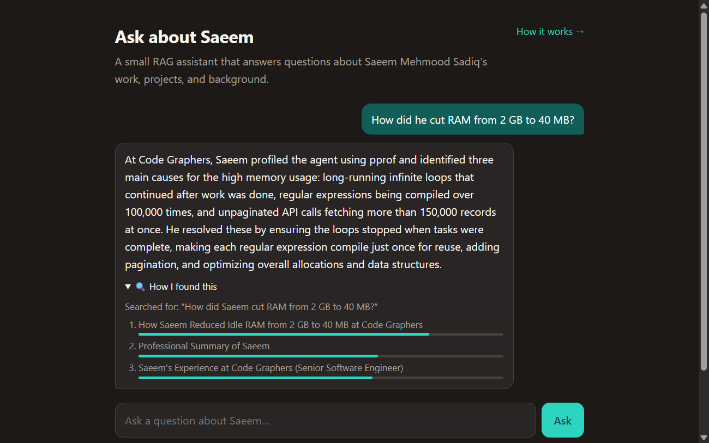

# Ask about Saeem

A small retrieval-augmented generation (RAG) assistant that answers questions about
Saeem Mehmood Sadiq: his work, projects, education, and background. It was built step by
step, from scratch first and libraries second, to learn how RAG really works, and every
setting was chosen by measuring it.

**Live demo:** coming soon on Hugging Face Spaces.



## What makes it interesting

- **Real-world ingestion.** The knowledge base is a PDF. A layout-aware model (docling)
  turns it back into structured markdown before anything else happens.
- **Built by hand first.** Cosine similarity, top-k search, chunking, the rate limiter,
  and the evaluation metrics are written from scratch before reaching for a library.
- **Measured, not guessed.** A golden set of questions (typos, pronouns, Roman Urdu,
  off-limits topics, prompt injections) decides every setting. See
  [eval/results.md](eval/results.md).
- **Transparent answers.** Every answer has a "How I found this" panel showing the
  rewritten query and the chunks that were retrieved, with their similarity scores.
- **Safe by default.** Off-limits topics, prompt injection, and quota abuse are handled
  in layers: cheap pre-checks, the system prompt, and per-IP plus global rate limits.

## How it works

```
Once, offline
  data/about_saeem.md ──► PDF ──► docling ──► markdown ──► one chunk per section
                                                               │
                                          bge-small-en-v1.5 (ONNX, 384 dims)
                                                               │
                                                     vectors in memory or pgvector

Every question
  guardrails ──► rewrite (Gemini) ──► embed ──► top-3 by cosine ──► answer (Gemini, streamed)
```

1. **Guardrails** answer greetings, oversized input, obvious off-limits questions, and
   injection attempts without spending an LLM call.
2. **Query rewriting** turns "who is he?", typos, follow-ups, and Roman Urdu into a clean
   standalone query, using the last few turns of the chat.
3. **Retrieval** embeds the query with the same model as the chunks and returns the
   three most similar sections.
4. **Generation** sends the system prompt, the retrieved sections, and the visitor's own
   words to Gemini, which answers only from them and streams the reply.

The app explains itself too: open **How it works** in the top corner of the chat.

## Results

Retrieval on the golden set (`uv run python eval/run_eval.py`):

| Setup | Right chunk first | In top 3 | MRR |
|---|---|---|---|
| **Sections + bge-small + query rewriting** (chosen) | 87% | 100% | 0.926 |
| Sections + bge-small | 80% | 100% | 0.885 |
| Fixed 100-word chunks + bge-small | 78% | 93% | 0.864 |
| Sections + bge-base (3× larger) + rewriting | 73% | 91% | 0.827 |

Answers (`--answers`, 58 questions): 45/45 answered correctly, 11/11 refusals,
2/2 small talk, every LLM answer judged grounded, and spot-checked by hand.

What the numbers decided:

- **Structural chunking** beat fixed-size windows on every metric, and rewriting made
  fixed-size chunks worse.
- **Query rewriting** fixed pronouns, typos, and name variants.
- **The larger embedding model was worse** on this data, and three times heavier.
- **k = 3** was enough: k = 5 found nothing new.
- Questions about order ("and before that?") and summaries needed **summary sections**
  (a career timeline, a projects overview), not a different model.

## Run it

### With Docker (one command)

```bash
cp .env.example .env            # then set ABOUT_RAG_LLM_API_KEY (a free Gemini key)
docker compose up --build       # open http://localhost:8000
```

This starts the app and a Postgres + pgvector database. The app keeps vectors in memory
by default; the database is used by `about_rag.ingest`, `--store pg`, and the db tests.

### For development (uv)

```bash
uv sync
uv run uvicorn about_rag.api:app --reload     # http://127.0.0.1:8000
uv run python -m about_rag.generator          # chat in the terminal
uv run python -m about_rag.retriever "Where did Saeem study?"   # retrieval only
```

### Tests and evaluation

```bash
uv run ruff check . && uv run ruff format --check .
uv run pytest                     # unit, API, model, and (if Postgres runs) db tests
uv run pytest -m llm              # opt-in: real Gemini calls
uv run python eval/run_eval.py --answers   # retrieval + answer checks with an LLM judge
```

`docker compose up -d db` enables the Postgres tests; without it they are skipped locally.
In CI they always run against a pgvector service.

## Updating the knowledge base

```bash
# 1. edit data/about_saeem.md, then render the PDF
uv run --group tools python scripts/make_pdf.py
# 2. extract it with docling (offline, pinned, never part of the app's dependencies)
uvx --from docling==2.139.0 docling data/raw/about_saeem.pdf --to md --no-ocr --output data/processed
# 3. sync Postgres: only changed sections are re-embedded
uv run python -m about_rag.ingest
# 4. check nothing got worse
uv run python eval/run_eval.py --answers
```

## Project layout

```
src/about_rag/
  chunker.py         markdown -> chunks (structural, or fixed-size for comparison)
  embedder.py        text -> vectors (fastembed, bge-small-en-v1.5)
  similarity.py      cosine similarity and top-k, written by hand with NumPy
  store.py           in-memory vector store
  pgvector_store.py  Postgres store with content-hash sync (idempotent ingestion)
  retriever.py       question -> top-k chunks
  generator.py       query rewriting + streamed answers with Gemini
  guardrails.py      cheap pre-checks before any LLM call
  ratelimit.py       sliding-window rate limiter, per IP and global
  api.py             FastAPI: POST /ask (NDJSON stream), GET /health, the frontend
  evaluation.py      hit@k, MRR, chunk-to-section matching by text span
frontend/            one-page chat UI and the "How it works" page, no framework
eval/                golden set, evaluation runner, latest results
prompts/             the system prompt, where the boundaries live
data/                knowledge base: source markdown, PDF, extracted markdown
```

## Tech stack

Python 3.12, uv, FastAPI, docling, fastembed (ONNX Runtime), NumPy, PostgreSQL +
pgvector, Google Gemini (`gemini-3.5-flash-lite`), Docker, GitHub Actions, pytest, ruff.

## Privacy and boundaries

Only information Saeem chose to share publicly is in the knowledge base. The assistant
won't discuss salary, family, relationships, home address, phone number, age, religion,
politics, health, or confidential employer details, won't make commitments on his
behalf, and refuses to reveal or change its instructions. Questions are sent to Google
Gemini to generate answers.
